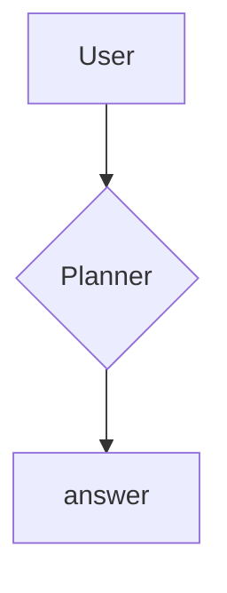

# Title That Gets Dropped By The Pipeline

## Execution Plan

A paragraph with **bold**, *italic*, `code`, and a [link](https://example.com).
A second line in the same paragraph.

### Hero Slice

> A blockquote line one.
> Blockquote line two.

- First bullet with **bold**
- Second bullet

1. First ordered step
2. Second ordered step

| Component | Type |
|-----------|------|
| IntakeMessage__c | CustomObject |
| TriageAgent | Agentforce |

---

A paragraph after a horizontal rule, with an escaped <tag> & ampersand.



```apex
public class Foo { // <bar> & baz }
```

#### Post-Config Steps
