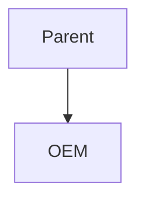

# PS-NPI-FORGE Phase 5 — Canvas assembly + HTML render + Mermaid

> **For agentic workers:** REQUIRED SUB-SKILL: Use superpowers:subagent-driven-development (recommended) or superpowers:executing-plans to implement this plan task-by-task. Steps use checkbox (`- [ ]`) syntax for tracking.

**Goal:** Render per-effort artifact markdown into shareable SLDS-styled HTML and assemble a Key Resources `canvas/index.html` hub (artifact cards with status + confidence badges + the Next Steps & Blockers register), with Mermaid diagrams themed to SLDS — live via CDN in HTML, capability-gated for `mmdc` SVG export.

**Architecture:** Mechanical→Python (two focused stdlib scripts: `md_to_html.py` ports the proven `pie-poc-forge` converter; `canvas.py` assembles the hub from the manifest), judgment→refs (`mermaid-diagrams.md`). An SLDS `document-shell.html` carries the Mermaid CDN. CI-tested with golden fixtures; the live `mmdc` export is capability-gated (absent → report-and-skip, never block).

**Tech Stack:** Python 3 stdlib only; the existing `tests/validate_skill.py` harness (`@check`, `_load_script`, `read`, `exists`, fixtures under `tests/fixtures/`); HTML/CSS (SLDS palette); Mermaid `@11` ESM CDN.

## Global Constraints

- **Skill location:** `~/.claude/skills/ps-npi-forge/` (own git repo; remote `origin` → private `github.com/bstaubersalesforce/ps-npi-forge`).
- **Python:** stdlib only. Suite runs `python3 tests/validate_skill.py`; must stay green and grow. Scripts are side-effect-free libraries where practical; `md_to_html.py` keeps its CLI (ported) but its core `md_to_html(md)->str` is pure and is what the suite tests. `canvas.py`'s core `build_index(manifest, html_present)->str` is pure.
- **ARTIFACT_REGISTRY (verbatim):** `00-executive-summary`, `01-brief`, `02-slide-summary`, `03-internal-enablement`, `04-internal-faq`, `05-external-faq`, `06-license-entitlements`, `07-addon-tiering`, `08-setup-guide`, `09-org-provisioning-validation`, `10-partner-profile-pov`.
- **SLDS palette (verbatim from style-conventions.md):** brand blue `#0176d3`; navy `#032d60`; tint bg `#f0f5fc`/`#eef4ff`; panel `#f8fafc`; body `#181818`; card border `#e5e5e5`. RAG: green `#2e7d32`, amber `#e65100`, red `#c62828`. Font stack: `'Salesforce Sans', 'Helvetica Neue', Arial, sans-serif`.
- **Mermaid theme directive (verbatim, single source):**
  `%%{init: {"theme":"base","themeVariables":{"primaryColor":"#f0f5fc","primaryTextColor":"#032d60","primaryBorderColor":"#0176d3","lineColor":"#444444","secondaryColor":"#f8fafc","tertiaryColor":"#ffffff","fontFamily":"Salesforce Sans, Helvetica Neue, Arial, sans-serif"}} }%%`
- **Mermaid CDN:** `https://cdn.jsdelivr.net/npm/mermaid@11/dist/mermaid.esm.min.mjs`, `mermaid.initialize({ startOnLoad: true })`. A ```mermaid fence → `<pre class="mermaid">` with source kept VERBATIM (not HTML-escaped); other fences → escaped `<pre><code>`.
- **§6 format rule:** narrative/shareable artifacts (00,01,02,03,05,10) get MD+HTML; reference artifacts (04,08,09) MD-only UNLESS they carry a diagram. `canvas.py` decides per artifact from the format rule + actual `.html` presence, NOT a frozen list.
- **`mmdc` capability-gated:** it is ABSENT on this machine. The SVG-export path must detect-and-report-and-skip (`npm i -g @mermaid-js/mermaid-cli`), never raise, never block.
- **Refusal rules unchanged:** official docs only; entitlements human-confirmed; pricing placeholders; Org62 read-only; never publish to Slack w/o confirm (Slack is Phase 6, not here); never silently drop an uncertainty.
- **Effort output lives outside the repo** at `/Users/bstauber/claude-projects/ps-npi-efforts/<release>/<product-slug>/` (`artifacts/`, `canvas/`); nothing there is committed. Skill code + templates + fixtures live in the repo.
- **Each new script gets a behavioral test (skill-forge R-TEST-04):** loaded via `_load_script`, exercised against a golden fixture under `tests/fixtures/`.

## File Structure

- `templates/document-shell.html` — **create**: SLDS HTML shell + Mermaid CDN + metadata tokens.
- `scripts/md_to_html.py` — **create**: ported markdown→shell converter (pure core + CLI).
- `scripts/canvas.py` — **create**: `build_index(manifest, html_present)` → canvas/index.html hub.
- `scripts/mermaid_export.py` — **create**: capability-gated `mmdc` SVG export (detect/report/skip).
- `refs/mermaid-diagrams.md` — **create**: SLDS `%%{init}%%` directive + named diagram types.
- `templates/00-executive-summary.md`, `06-…`, `07-…`, `10-…` — **modify**: add a `{{*_DIAGRAM}}` themed-fence slot + generator guidance.
- `tests/validate_skill.py` — **modify**: add R-HTML-01 (shell), R-MD2H-01 (converter), R-MERMAID-01 (ref directive parity), R-CANVAS-01 (hub), R-CANVAS-02 (mmdc gating); add the ref to `EXPECTED_REFS`.
- `tests/fixtures/render/sample-artifact.md` — **create**: a small artifact-shaped fixture (headings, table, blockquote, a mermaid fence) for the converter test.
- `SKILL.md` — **modify**: outputs/canvas section; reference `refs/mermaid-diagrams.md`.
- `BACKLOG.md` — **modify**: mark Phase 5 done; note B3 still open.
- `docs/superpowers/acceptance/2026-06-23-phase5-canvas.md` — **create**.

---

### Task 1: SLDS document shell + shell-content check

**Files:**
- Create: `templates/document-shell.html`
- Modify: `tests/validate_skill.py` (add R-HTML-01)

**Interfaces:**
- Consumes: `read`, `exists`.
- Produces: `templates/document-shell.html` carrying tokens `{{TITLE}}`, `{{LABEL}}`, `{{RELEASE}}`, `{{GENERATED_DATE}}`, `{{BODY}}`, `{{HOME_HREF}}`; the Mermaid CDN; the SLDS palette/font.

- [ ] **Step 1: Write the failing test** — append to `tests/validate_skill.py` before `# ---- runner`:

```python
# ---- R-HTML-01: SLDS document shell carries the CDN, theme, and tokens --
@check("R-HTML-01: document-shell.html carries the Mermaid CDN, SLDS theme, and the required metadata tokens")
def t_document_shell():
    path = "templates/document-shell.html"
    assert exists(path), f"missing {path}"
    s = read(path)
    assert "cdn.jsdelivr.net/npm/mermaid@11" in s, "shell missing the mermaid@11 CDN"
    assert "startOnLoad: true" in s or "startOnLoad:true" in s, "shell missing mermaid.initialize startOnLoad"
    assert "Salesforce Sans" in s, "shell missing the Salesforce Sans font stack"
    assert "#0176d3" in s, "shell missing the SLDS brand-blue"
    assert "print-color-adjust" in s, "shell missing print-color-adjust for dark fills"
    for tok in ("{{TITLE}}", "{{LABEL}}", "{{RELEASE}}", "{{GENERATED_DATE}}", "{{BODY}}", "{{HOME_HREF}}"):
        assert tok in s, f"shell missing token {tok}"
```

- [ ] **Step 2: Run to verify it FAILS**

Run: `cd ~/.claude/skills/ps-npi-forge && python3 tests/validate_skill.py`
Expected: FAIL on R-HTML-01 (shell missing).

- [ ] **Step 3: Create `templates/document-shell.html`** (verbatim):

```html
<!DOCTYPE html>
<html lang="en">
<head>
  <meta charset="utf-8">
  <meta name="viewport" content="width=device-width, initial-scale=1">
  <title>{{TITLE}} — {{LABEL}}</title>
  <style>
    :root {
      --brand: #0176d3; --brand-dark: #014486; --navy: #032d60;
      --tint: #f0f5fc; --panel: #f8fafc; --rule: #e5e5e5; --body: #181818;
    }
    * { box-sizing: border-box; }
    body {
      font-family: "Salesforce Sans", "Helvetica Neue", Arial, sans-serif;
      color: var(--body); line-height: 1.5; margin: 0; background: #fff;
    }
    .doc { max-width: 880px; margin: 0 auto; padding: 2.5rem 1.75rem 4rem; }
    .doc-header { border-bottom: 2px solid var(--brand); padding-bottom: 0.75rem; margin-bottom: 1.5rem; }
    .eyebrow { text-transform: uppercase; letter-spacing: 0.1em; font-size: 0.7rem; color: #444444; }
    h1 { font-size: 1.5rem; font-weight: 700; color: var(--navy); margin: 0.25rem 0; }
    .meta { font-size: 0.8rem; color: #444444; }
    .meta .release-badge {
      display: inline-block; background: var(--brand); color: #fff; font-size: 11px;
      padding: 2px 9px; border-radius: 100px; margin-left: 8px;
    }
    h2 { color: var(--navy); border-bottom: 1px solid var(--rule); padding-bottom: 0.2rem; margin-top: 1.75rem; }
    h3 { color: var(--brand-dark); }
    .content a { color: var(--brand); }
    .content table { border-collapse: collapse; width: 100%; margin: 1rem 0; font-size: 0.9rem; }
    .content th { background: var(--navy); color: #fff; text-align: left; padding: 7px 10px; }
    .content td { border: 1px solid var(--rule); padding: 6px 10px; }
    .content blockquote {
      background: var(--tint); border-left: 4px solid var(--brand);
      margin: 1rem 0; padding: 0.6rem 1rem; border-radius: 0 6px 6px 0;
    }
    .content pre { background: var(--panel); border: 1px solid var(--rule); border-radius: 6px; padding: 0.8rem; overflow-x: auto; }
    .content pre.mermaid { background: #fff; border: none; text-align: center; }
    hr { border: none; border-top: 1px solid var(--rule); margin: 1.5rem 0; }
    .doc-footer { margin-top: 2.5rem; border-top: 1px solid var(--rule); padding-top: 0.75rem; font-size: 0.72rem; color: #444444; }
    @media print {
      .doc-header, .content thead tr, .content blockquote { -webkit-print-color-adjust: exact; print-color-adjust: exact; }
    }
  </style>
</head>
<body>
  <div class="doc">
    <a class="home-link" href="{{HOME_HREF}}" style="position:fixed;top:14px;left:14px;z-index:9999;font-size:12px;font-weight:700;letter-spacing:0.04em;text-decoration:none;color:#fff;background:#0176d3;padding:7px 14px;border-radius:100px;box-shadow:0 2px 8px rgba(0,0,0,0.25);">&#8592; Key Resources</a>
    <div class="doc-header">
      <div class="eyebrow">{{LABEL}}</div>
      <h1>{{TITLE}}</h1>
      <div class="meta"><span>{{GENERATED_DATE}}</span><span class="release-badge">{{RELEASE}}</span></div>
    </div>
    <div class="content">
{{BODY}}
    </div>
    <div class="doc-footer">Generated by ps-npi-forge | {{RELEASE}} | {{GENERATED_DATE}}</div>
  </div>
<!-- Mermaid live render: renders every <pre class="mermaid"> on load; no-op on diagram-free artifacts.
     The .mmd/fence source is the offline/deck path (see refs/mermaid-diagrams.md). -->
<script type="module">
  import mermaid from "https://cdn.jsdelivr.net/npm/mermaid@11/dist/mermaid.esm.min.mjs";
  mermaid.initialize({ startOnLoad: true, securityLevel: "loose" });
</script>
</body>
</html>
```

- [ ] **Step 4: Run to verify PASS**

Run: `cd ~/.claude/skills/ps-npi-forge && python3 tests/validate_skill.py`
Expected: `31/31 checks passed`, exit 0 (30 prior + R-HTML-01).

- [ ] **Step 5: Commit**

```bash
cd ~/.claude/skills/ps-npi-forge
git add templates/document-shell.html tests/validate_skill.py
git commit -m "feat(canvas): SLDS document shell with Mermaid CDN + metadata tokens"
```

---

### Task 2: md_to_html.py converter + render checks

**Files:**
- Create: `scripts/md_to_html.py`
- Create: `tests/fixtures/render/sample-artifact.md`
- Modify: `tests/validate_skill.py` (add R-MD2H-01)

**Interfaces:**
- Consumes: nothing (pure core).
- Produces: `md_to_html(md: str) -> str` (the markdown subset → HTML body; a ```mermaid fence → verbatim `<pre class="mermaid">`); and a CLI `main()` that fills `document-shell.html` tokens (`{{TITLE}}`, `{{LABEL}}`, `{{RELEASE}}`, `{{GENERATED_DATE}}`, `{{BODY}}`, `{{HOME_HREF}}`) and exits non-zero on any surviving `{{TOKEN}}`.

- [ ] **Step 1: Create the converter fixture** `tests/fixtures/render/sample-artifact.md`:

```markdown
# Sample Artifact

> **Status:** drafted · **Confidence:** 0.5 — sample

## Section One
A paragraph with **bold**, *italic*, `code`, and a [link](https://help.salesforce.com).

## A Table
| Grant | Category | Quantity |
|-------|----------|----------|
| UE Sites | Feature | 1,000,000 |

## A Diagram


## A List
- one
- two
```

- [ ] **Step 2: Write the failing test** — append before `# ---- runner`:

```python
# ---- R-MD2H-01: markdown -> HTML converter (subset + mermaid verbatim) --
@check("R-MD2H-01: md_to_html renders the artifact subset; a mermaid fence becomes a verbatim <pre class=mermaid>, other fences escaped")
def t_md_to_html():
    m = _load_script("scripts/md_to_html.py", "md2h_mod")
    md = read("tests/fixtures/render/sample-artifact.md")
    h = m.md_to_html(md)
    assert "<h1>Sample Artifact</h1>" in h, "H1 not rendered"
    assert "<h2>Section One</h2>" in h, "H2 not rendered"
    assert "<strong>bold</strong>" in h and "<em>italic</em>" in h and "<code>code</code>" in h, "inline not rendered"
    assert '<a href="https://help.salesforce.com">link</a>' in h, "link not rendered"
    assert "<table>" in h and "<th>Grant</th>" in h and "<td>UE Sites</td>" in h, "GFM table not rendered"
    assert "<blockquote>" in h, "blockquote not rendered"
    assert "<ul><li>one</li><li>two</li></ul>" in h, "list not rendered"
    # mermaid fence: verbatim <pre class="mermaid">, NOT escaped
    assert '<pre class="mermaid">' in h, "mermaid fence not emitted as <pre class=mermaid>"
    assert "graph TD; A[Parent] --> B[OEM];" in h, "mermaid source must be kept verbatim (not escaped)"
    assert "&lt;pre" not in h, "mermaid/source should not be double-escaped"
    # a non-mermaid fence would be escaped — verify the escaper path exists by a direct call
    esc = m.md_to_html("```python\nx = 1 < 2\n```")
    assert "<pre><code>" in esc and "1 &lt; 2" in esc, "non-mermaid fence must be escaped <pre><code>"
```

- [ ] **Step 3: Run to verify it FAILS**

Run: `cd ~/.claude/skills/ps-npi-forge && python3 tests/validate_skill.py`
Expected: FAIL on R-MD2H-01 (`scripts/md_to_html.py` not found).

- [ ] **Step 4: Create `scripts/md_to_html.py`** (ported from `pie-poc-forge/scripts/md-to-html.py`, adapted to the ps-npi-forge shell tokens):

```python
#!/usr/bin/env python3
"""
md_to_html.py — render a ps-npi-forge artifact's Markdown into the SLDS document shell.

The one sanctioned Markdown->HTML converter (do not reinvent inline). Handles the subset the
artifact templates emit: ATX headings, GFM pipe tables, ordered/unordered lists, blockquotes,
horizontal rules, fenced code blocks, paragraphs, and inline bold/italic/code/links. Injects the
rendered body into templates/document-shell.html and fills its metadata tokens.

A ```mermaid fence renders as <pre class="mermaid"> with its source kept VERBATIM (not HTML-escaped)
so the shell's Mermaid CDN renders it live; any other ```lang fence renders as an escaped
<pre><code> block. Ported from pie-poc-forge/scripts/md-to-html.py.

Usage:
    python3 md_to_html.py --md <artifact.md> --shell templates/document-shell.html \
        --out <artifact.html> --title "Agentforce for Healthcare" --label "Executive Summary" \
        --release "summer-26" --date "2026-06-23" --home "index.html"   # omit --home for standalone
Exits non-zero if any {{TOKEN}} remains unfilled.
"""
import argparse, html, re, sys

def _inline(text):
    text = html.escape(text)
    text = re.sub(r'`(.+?)`', r'<code>\1</code>', text)
    text = re.sub(r'\*\*(.+?)\*\*', r'<strong>\1</strong>', text)
    text = re.sub(r'(?<!\*)\*(?!\*)(.+?)(?<!\*)\*(?!\*)', r'<em>\1</em>', text)
    text = re.sub(r'\[(.+?)\]\((.+?)\)', r'<a href="\2">\1</a>', text)
    return text

def md_to_html(md):
    lines = md.split("\n")
    out, i = [], 0
    while i < len(lines):
        ln = lines[i]
        if not ln.strip():
            i += 1; continue
        mfence = re.match(r'^\s*```\s*([A-Za-z0-9_-]*)\s*$', ln)
        if mfence:
            lang = mfence.group(1).lower(); i += 1; body = []
            while i < len(lines) and not re.match(r'^\s*```\s*$', lines[i]):
                body.append(lines[i]); i += 1
            i += 1
            code = "\n".join(body)
            if lang == "mermaid":
                out.append('<pre class="mermaid">' + code + '</pre>')
            else:
                out.append('<pre><code>' + html.escape(code) + '</code></pre>')
            continue
        if '|' in ln and i + 1 < len(lines) and re.match(r'^\s*\|?[\s:|-]+\|[\s:|-]+\|?\s*$', lines[i + 1]):
            header = [c.strip() for c in ln.strip().strip('|').split('|')]; i += 2; rows = []
            while i < len(lines) and '|' in lines[i] and lines[i].strip():
                rows.append([c.strip() for c in lines[i].strip().strip('|').split('|')]); i += 1
            t = ['<table><thead><tr>'] + [f'<th>{_inline(h)}</th>' for h in header] + ['</tr></thead><tbody>']
            for r in rows:
                t.append('<tr>' + ''.join(f'<td>{_inline(c)}</td>' for c in r) + '</tr>')
            t.append('</tbody></table>'); out.append(''.join(t)); continue
        m = re.match(r'^(#{1,4})\s+(.*)$', ln)
        if m:
            lv = len(m.group(1)); out.append(f'<h{lv}>{_inline(m.group(2))}</h{lv}>'); i += 1; continue
        if re.match(r'^\s*>\s?', ln):
            buf = []
            while i < len(lines) and re.match(r'^\s*>\s?', lines[i]):
                buf.append(_inline(re.sub(r'^\s*>\s?', '', lines[i]))); i += 1
            out.append('<blockquote>' + '<br>'.join(buf) + '</blockquote>'); continue
        if re.match(r'^\s*[-*]\s+', ln):
            buf = []
            while i < len(lines) and re.match(r'^\s*[-*]\s+', lines[i]):
                buf.append('<li>' + _inline(re.sub(r'^\s*[-*]\s+', '', lines[i])) + '</li>'); i += 1
            out.append('<ul>' + ''.join(buf) + '</ul>'); continue
        if re.match(r'^\s*\d+\.\s+', ln):
            buf = []
            while i < len(lines) and re.match(r'^\s*\d+\.\s+', lines[i]):
                buf.append('<li>' + _inline(re.sub(r'^\s*\d+\.\s+', '', lines[i])) + '</li>'); i += 1
            out.append('<ol>' + ''.join(buf) + '</ol>'); continue
        if re.match(r'^\s*---+\s*$', ln):
            out.append('<hr>'); i += 1; continue
        buf = []
        while (i < len(lines) and lines[i].strip()
               and not re.match(r'^(#{1,4}\s|\s*[-*]\s|\s*\d+\.\s|\s*>|\s*---+\s*$)', lines[i])
               and '|' not in lines[i]):
            buf.append(_inline(lines[i])); i += 1
        if buf:
            out.append('<p>' + '<br>'.join(buf) + '</p>')
        else:
            i += 1
    return '\n'.join(out)

def main():
    ap = argparse.ArgumentParser(description="Render a ps-npi-forge artifact into the SLDS shell.")
    ap.add_argument('--md', required=True); ap.add_argument('--shell', required=True)
    ap.add_argument('--out', required=True); ap.add_argument('--title', required=True)
    ap.add_argument('--label', required=True); ap.add_argument('--release', required=True)
    ap.add_argument('--date', required=True); ap.add_argument('--home', default=None)
    args = ap.parse_args()
    with open(args.md) as f: md = f.read()
    md = re.sub(r'^#\s+.*\n', '', md, count=1)  # drop leading H1; shell header renders the title
    with open(args.shell) as f: shell = f.read()
    body = md_to_html(md)
    filled = (shell.replace("{{TITLE}}", html.escape(args.title))
                   .replace("{{LABEL}}", html.escape(args.label))
                   .replace("{{RELEASE}}", html.escape(args.release))
                   .replace("{{GENERATED_DATE}}", html.escape(args.date))
                   .replace("{{BODY}}", body))
    if args.home:
        filled = filled.replace("{{HOME_HREF}}", html.escape(args.home))
    else:
        filled = re.sub(r'^\s*<a class="home-link".*?</a>\s*\n', '', filled, flags=re.MULTILINE)
        filled = filled.replace("{{HOME_HREF}}", "")
    leftover = re.findall(r'\{\{[A-Z0-9_]+\}\}', filled)
    if leftover:
        sys.stderr.write(f"ERROR: unfilled tokens remain: {sorted(set(leftover))}\n"); sys.exit(1)
    with open(args.out, 'w') as f: f.write(filled)
    print(args.out)

if __name__ == '__main__':
    main()
```

- [ ] **Step 5: Run to verify PASS**

Run: `cd ~/.claude/skills/ps-npi-forge && python3 tests/validate_skill.py`
Expected: `32/32 checks passed`, exit 0.

- [ ] **Step 6: Commit**

```bash
cd ~/.claude/skills/ps-npi-forge
git add scripts/md_to_html.py tests/fixtures/render/sample-artifact.md tests/validate_skill.py
git commit -m "feat(canvas): md_to_html converter (subset + verbatim mermaid fence) + fixture"
```

---

### Task 3: mermaid-diagrams ref + named-diagram template slots

**Files:**
- Create: `refs/mermaid-diagrams.md`
- Modify: `tests/validate_skill.py` (add R-MERMAID-01; add ref to `EXPECTED_REFS`)
- Modify: `templates/00-executive-summary.md`, `templates/06-license-entitlements.md`, `templates/07-addon-tiering.md`, `templates/10-partner-profile-pov.md` (add a `{{*_DIAGRAM}}` slot)
- Modify: `SKILL.md` (reference the ref)

**Interfaces:**
- Consumes: `read`, `exists`.
- Produces: `refs/mermaid-diagrams.md` (the SLDS directive + diagram types); four new UPPER_SNAKE diagram tokens (`{{STATUS_ROLLUP_DIAGRAM}}`, `{{COMPOSITION_DIAGRAM}}`, `{{TIER_DIAGRAM}}`, `{{PARTNER_FIT_DIAGRAM}}`).

- [ ] **Step 1: Write the failing test** — append before `# ---- runner`; add `refs/mermaid-diagrams.md` to `EXPECTED_REFS`.

In `EXPECTED_REFS`, add:

```python
    "refs/mermaid-diagrams.md",
```

Append the check:

```python
# ---- R-MERMAID-01: mermaid ref carries the canonical SLDS directive -----
@check("R-MERMAID-01: mermaid-diagrams ref exists, is referenced by SKILL.md, and carries the canonical SLDS %%{init}%% directive + named diagram types")
def t_mermaid_ref():
    path = "refs/mermaid-diagrams.md"
    assert exists(path), f"missing {path}"
    body = read(path)
    assert '%%{init:' in body and '"theme":"base"' in body, "missing the %%{init}%% base-theme directive"
    for tok in ('"primaryBorderColor":"#0176d3"', '"lineColor":"#444444"', 'Salesforce Sans'):
        assert tok in body, f"directive missing SLDS value: {tok}"
    low = body.lower()
    for diagram in ("status", "composition", "tier", "partner"):
        assert diagram in low, f"ref missing named diagram type: {diagram}"
    assert path in read("SKILL.md"), f"{path} not referenced by SKILL.md"
```

- [ ] **Step 2: Run to verify it FAILS**

Run: `cd ~/.claude/skills/ps-npi-forge && python3 tests/validate_skill.py`
Expected: FAIL on R-MERMAID-01 + R-ARCH-03 (ref missing).

- [ ] **Step 3: Create `refs/mermaid-diagrams.md`** (verbatim):

```markdown
# Mermaid diagrams (SLDS-themed)

Diagrams in ps-npi-forge artifacts are authored in **Mermaid**, themed to the SLDS palette, and
rendered live in the HTML view (`templates/document-shell.html` embeds the Mermaid `@11` CDN with
`startOnLoad: true`). The same fence renders natively on GitHub/GitLab. This ref is the self-contained
copy of the theme directive (source of truth: `style-conventions.md`); keep it in sync if the palette
changes.

## The single-source theme directive

Prepend this verbatim to every diagram fence:

```
%%{init: {"theme":"base","themeVariables":{"primaryColor":"#f0f5fc","primaryTextColor":"#032d60","primaryBorderColor":"#0176d3","lineColor":"#444444","secondaryColor":"#f8fafc","tertiaryColor":"#ffffff","fontFamily":"Salesforce Sans, Helvetica Neue, Arial, sans-serif"}} }%%
```

Border = SLDS `$brand-accessible` `#0176d3`; line = `$color-text-weak` `#444444`.

## Authoring

The generator (the draft->refine->validate cycle) fills each artifact's diagram token with a themed
fence whose CONTENT reflects the effort's real data -- diagrams are not static template strings. A
fence goes in a ` ```mermaid ` block (the converter emits it verbatim as `<pre class="mermaid">`).

## Named diagram types (which artifact, what it shows)

| Token | Artifact | Diagram |
|-------|----------|---------|
| `{{STATUS_ROLLUP_DIAGRAM}}` | #00 executive-summary | Status / blocker rollup: each artifact node colored by status, blockers called out. |
| `{{COMPOSITION_DIAGRAM}}` | #06 license-entitlements | Entitlement composition: parent product -> grant rows (by derived category). |
| `{{TIER_DIAGRAM}}` | #07 addon-tiering | Tier-decision view: Required / Recommended / Optional add-ons. |
| `{{PARTNER_FIT_DIAGRAM}}` | #10 partner-profile-pov | Partner-fit logic: why embedded/OEM fit *because* poor direct-SF target. |

## SVG / PNG for decks (capability-gated)

`@mermaid-js/mermaid-cli` (`mmdc -i x.mmd -o x.svg`) exports a fence to SVG/PNG for decks. It is
**capability-gated**: if `mmdc` is absent, keep the fence/`.mmd` source and report the install
(`npm i -g @mermaid-js/mermaid-cli`) -- never block the artifact. `scripts/mermaid_export.py` handles
the detect/export/report path.
```

- [ ] **Step 4: Add the diagram token slot to the four named templates.** For each, insert the slot as a new `## H2` section just before the footer `---` rule. Use exactly these headings + tokens:

In `templates/00-executive-summary.md`, before the footer `---`:

```markdown
## Status & blockers (diagram)
{{STATUS_ROLLUP_DIAGRAM}}
```

In `templates/06-license-entitlements.md`, before the footer `---`:

```markdown
## Entitlement composition (diagram)
{{COMPOSITION_DIAGRAM}}
```

In `templates/07-addon-tiering.md`, before the footer `---`:

```markdown
## Tier decision (diagram)
{{TIER_DIAGRAM}}
```

In `templates/10-partner-profile-pov.md`, before the footer `---`:

```markdown
## Partner-fit logic (diagram)
{{PARTNER_FIT_DIAGRAM}}
```

- [ ] **Step 5: Reference the ref in SKILL.md** — add after the existing "Entitlements:" line:

```markdown
**Diagrams & canvas:** artifacts carry SLDS-themed Mermaid diagrams (live via CDN in the HTML view)
and assemble into a Key Resources `canvas/index.html`; see [refs/mermaid-diagrams.md](refs/mermaid-diagrams.md).
```

- [ ] **Step 6: Run to verify PASS** (the new template tokens are UPPER_SNAKE → R-TEST-02 stays green; banner/footer untouched → R-TPL-02 green)

Run: `cd ~/.claude/skills/ps-npi-forge && python3 tests/validate_skill.py`
Expected: `33/33 checks passed`, exit 0.

- [ ] **Step 7: Commit**

```bash
cd ~/.claude/skills/ps-npi-forge
git add refs/mermaid-diagrams.md SKILL.md tests/validate_skill.py templates/00-executive-summary.md templates/06-license-entitlements.md templates/07-addon-tiering.md templates/10-partner-profile-pov.md
git commit -m "feat(canvas): mermaid-diagrams ref (SLDS directive + named types) + diagram slots in 00/06/07/10"
```

---

### Task 4: canvas.py — the Key Resources hub

**Files:**
- Create: `scripts/canvas.py`
- Modify: `tests/validate_skill.py` (add R-CANVAS-01)

**Interfaces:**
- Consumes: `scripts/manifest.py` (`ARTIFACT_REGISTRY`, `overall_confidence`), `_load_script`.
- Produces: `build_index(manifest: dict, html_present: dict) -> str`. `manifest` is a loaded effort manifest; `html_present` maps slug→bool (does an `.html` view exist?). Returns the full `canvas/index.html`. A `pending` artifact → a labeled gap card (no link). Each card shows a status + confidence badge; the page shows the overall confidence + the aggregated Next Steps & Blockers register (from per-artifact `placeholders`).

- [ ] **Step 1: Write the failing test** — append before `# ---- runner`:

```python
# ---- R-CANVAS-01: Key Resources hub assembly ---------------------------
@check("R-CANVAS-01: build_index emits a card per artifact with status+confidence badges, a labeled gap card for pending (no dead link), and the aggregated blocker register")
def t_canvas_index():
    c = _load_script("scripts/canvas.py", "canvas_mod")
    mani = _load_script("scripts/manifest.py", "canvas_manifest_mod")
    eff = mani.new_effort("summer-26", "agentforce-healthcare-oem", "Health Cloud EE/UE")
    eff = mani.set_status(eff, "01-brief", "verified")
    eff["artifacts"]["01-brief"]["confidence"] = 0.75
    eff = mani.set_status(eff, "09-org-provisioning-validation", "drafted")
    eff["artifacts"]["09-org-provisioning-validation"]["confidence"] = 0.35
    eff["artifacts"]["09-org-provisioning-validation"]["placeholders"] = [
        {"item": "Template ID", "owner": "Manish/John", "next_step": "request Template ID"}]
    # 00 left pending → must render as a labeled gap card, not a link
    html_present = {a: (a == "01-brief") for a in mani.ARTIFACT_REGISTRY}
    page = c.build_index(eff, html_present)
    assert "agentforce-healthcare-oem" in page and "summer-26" in page, "effort title/release missing"
    assert "01-brief.html" in page, "verified artifact with HTML must link to its .html"
    assert "0.75" in page and "0.35" in page, "confidence badges missing"
    # pending #00 → labeled gap card, no dead link
    assert "00-executive-summary.html" not in page, "pending artifact must NOT link to a nonexistent .html"
    assert "pending" in page.lower(), "pending status not shown"
    # blocker register aggregates placeholders with owner + next step
    assert "Template ID" in page and "Manish/John" in page and "request Template ID" in page, "blocker register missing the gap"
    # overall confidence (weighted floor = 0.0 here since pendings sit at 0.0) is shown
    assert "Overall confidence" in page or "overall confidence" in page, "overall confidence not shown"
```

- [ ] **Step 2: Run to verify it FAILS**

Run: `cd ~/.claude/skills/ps-npi-forge && python3 tests/validate_skill.py`
Expected: FAIL on R-CANVAS-01 (`scripts/canvas.py` not found).

- [ ] **Step 3: Create `scripts/canvas.py`** (verbatim):

```python
#!/usr/bin/env python3
"""
canvas.py — assemble the Key Resources hub (canvas/index.html) from an effort manifest.

Local HTML is the source of truth; the Slack canvas (Phase 6) is a projection of this. Reads the
loaded manifest + a slug->bool map of which artifacts have an .html view, and emits an SLDS-themed
index: effort title/release, overall confidence + status rollup, the aggregated Next Steps & Blockers
register, then one card per artifact. A `pending` artifact renders as a labeled gap card (NOT a dead
link). Stdlib-only, pure: build_index(manifest, html_present) -> str.
"""
import html as _html

# status -> RAG-ish swatch (SLDS-aligned; decorative)
_STATUS_COLOR = {
    "verified": "#2e7d32", "drafted": "#e65100", "in_progress": "#e65100",
    "pending": "#c62828", "pulled": "#444444",
}
_LABEL = {
    "00-executive-summary": "Executive Summary", "01-brief": "Use-Case & Details Brief",
    "02-slide-summary": "Slide Summary", "03-internal-enablement": "Internal Enablement",
    "04-internal-faq": "Internal FAQ", "05-external-faq": "External FAQ",
    "06-license-entitlements": "License & Entitlements", "07-addon-tiering": "Add-On Tiering",
    "08-setup-guide": "Setup Guide", "09-org-provisioning-validation": "Org-Provisioning Validation",
    "10-partner-profile-pov": "Ideal-Partner POV",
}

def _overall(manifest):
    vals = [r["confidence"] for r in manifest["artifacts"].values() if r.get("status") != "pulled"]
    return min(vals) if vals else 0.0

def _card(slug, rec, has_html):
    status = rec.get("status", "pending")
    conf = rec.get("confidence", 0.0)
    color = _STATUS_COLOR.get(status, "#444444")
    label = _LABEL.get(slug, slug)
    badge = (f'<span class="badge" style="background:{color}">{_html.escape(status)}</span>'
             f'<span class="conf">conf {conf}</span>')
    if has_html and status != "pending":
        title = f'<a href="{slug}.html">{_html.escape(label)}</a>'
        cls = "card"
    else:
        # labeled gap card — no dead link
        title = f'{_html.escape(label)} <span class="gap">— not yet generated</span>'
        cls = "card gap-card"
    return f'<div class="{cls}"><div class="card-title">{title}</div><div class="card-meta">{badge}</div></div>'

def _blockers(manifest):
    rows = []
    for slug in manifest["artifacts"]:
        for ph in manifest["artifacts"][slug].get("placeholders") or []:
            item = _html.escape(str(ph.get("item", "")))
            owner = _html.escape(str(ph.get("owner", "")))
            nxt = _html.escape(str(ph.get("next_step", "")))
            rows.append(f'<tr><td>{_LABEL.get(slug, slug)}</td><td>{item}</td><td>{owner}</td><td>{nxt}</td></tr>')
    if not rows:
        return '<p>No open blockers.</p>'
    return ('<table class="blockers"><thead><tr><th>Artifact</th><th>Gap</th><th>Owner</th>'
            '<th>Next step</th></tr></thead><tbody>' + ''.join(rows) + '</tbody></table>')

def build_index(manifest, html_present):
    release = _html.escape(str(manifest.get("release", "")))
    slug = _html.escape(str(manifest.get("product_slug", "")))
    overall = _overall(manifest)
    cards = "\n".join(_card(s, manifest["artifacts"][s], html_present.get(s, False))
                      for s in manifest["artifacts"])
    blockers = _blockers(manifest)
    return f"""<!DOCTYPE html>
<html lang="en"><head><meta charset="utf-8">
<meta name="viewport" content="width=device-width, initial-scale=1">
<title>{slug} — Key Resources</title>
<style>
 body {{ font-family: "Salesforce Sans","Helvetica Neue",Arial,sans-serif; color:#181818; margin:0; background:#f8fafc; }}
 .wrap {{ max-width: 960px; margin: 0 auto; padding: 2.5rem 1.75rem 4rem; }}
 .eyebrow {{ text-transform:uppercase; letter-spacing:0.1em; font-size:0.7rem; color:#444; }}
 h1 {{ color:#032d60; font-size:1.6rem; margin:0.25rem 0; }}
 .release-badge {{ display:inline-block; background:#0176d3; color:#fff; font-size:11px; padding:2px 9px; border-radius:100px; }}
 .overall {{ background:#eef4ff; border-left:4px solid #0176d3; padding:0.7rem 1rem; border-radius:0 6px 6px 0; margin:1.25rem 0; }}
 h2 {{ color:#032d60; border-bottom:1px solid #e5e5e5; padding-bottom:0.2rem; margin-top:2rem; }}
 .grid {{ display:grid; grid-template-columns:repeat(auto-fill,minmax(260px,1fr)); gap:0.9rem; }}
 .card {{ background:#fff; border:1px solid #e5e5e5; border-radius:8px; padding:0.9rem 1rem; }}
 .gap-card {{ background:#f8fafc; border-style:dashed; }}
 .card-title a {{ color:#0176d3; text-decoration:none; font-weight:600; }}
 .gap {{ color:#c62828; font-size:0.82rem; }}
 .badge {{ color:#fff; font-size:10px; padding:2px 8px; border-radius:100px; text-transform:uppercase; letter-spacing:0.05em; }}
 .conf {{ font-size:0.78rem; color:#444; margin-left:8px; }}
 table.blockers {{ border-collapse:collapse; width:100%; font-size:0.86rem; }}
 table.blockers th {{ background:#032d60; color:#fff; text-align:left; padding:7px 10px; }}
 table.blockers td {{ border:1px solid #e5e5e5; padding:6px 10px; }}
</style></head>
<body><div class="wrap">
 <div class="eyebrow">Key Resources</div>
 <h1>{slug} <span class="release-badge">{release}</span></h1>
 <div class="overall"><strong>Overall confidence:</strong> {overall} <span style="color:#444">(weighted floor across artifacts)</span></div>
 <h2>Next Steps &amp; Blockers</h2>
 {blockers}
 <h2>Artifacts</h2>
 <div class="grid">
 {cards}
 </div>
</div></body></html>"""
```

- [ ] **Step 4: Run to verify PASS**

Run: `cd ~/.claude/skills/ps-npi-forge && python3 tests/validate_skill.py`
Expected: `34/34 checks passed`, exit 0.

- [ ] **Step 5: Commit**

```bash
cd ~/.claude/skills/ps-npi-forge
git add scripts/canvas.py tests/validate_skill.py
git commit -m "feat(canvas): build_index hub — artifact cards, status/confidence badges, gap cards, blocker register"
```

---

### Task 5: mmdc capability-gated SVG export + SKILL.md outputs section

**Files:**
- Create: `scripts/mermaid_export.py`
- Modify: `tests/validate_skill.py` (add R-CANVAS-02)
- Modify: `SKILL.md` (outputs/canvas section + run-mode note)
- Modify: `BACKLOG.md` (mark Phase 5 done; note B3 open)

**Interfaces:**
- Consumes: nothing (stdlib + optional `shutil.which`).
- Produces: `mmdc_available() -> bool`; `export_svg(mmd_path, out_path) -> dict` returning `{"ok": bool, "skipped": bool, "message": str}` — never raises; when `mmdc` is absent returns `{"ok": False, "skipped": True, "message": "<install line>"}`.

- [ ] **Step 1: Write the failing test** — append before `# ---- runner`:

```python
# ---- R-CANVAS-02: mmdc export is capability-gated (report-and-skip) -----
@check("R-CANVAS-02: mermaid_export reports mmdc availability and skips gracefully (never raises) when absent")
def t_mermaid_export_gating():
    e = _load_script("scripts/mermaid_export.py", "mmdc_mod")
    assert isinstance(e.mmdc_available(), bool), "mmdc_available must return a bool"
    # export to a path under a tmp dir; with mmdc absent it must report-and-skip, not raise
    import tempfile, os as _os
    d = tempfile.mkdtemp()
    res = e.export_svg(_os.path.join(d, "x.mmd"), _os.path.join(d, "x.svg"))
    assert isinstance(res, dict) and "ok" in res and "skipped" in res and "message" in res, res
    if not e.mmdc_available():
        assert res["skipped"] is True and res["ok"] is False, "absent mmdc must skip, not succeed"
        assert "mermaid-cli" in res["message"], "skip message must carry the install line"
```

- [ ] **Step 2: Run to verify it FAILS**

Run: `cd ~/.claude/skills/ps-npi-forge && python3 tests/validate_skill.py`
Expected: FAIL on R-CANVAS-02 (`scripts/mermaid_export.py` not found).

- [ ] **Step 3: Create `scripts/mermaid_export.py`** (verbatim):

```python
#!/usr/bin/env python3
"""
mermaid_export.py — capability-gated SVG/PNG export for Mermaid diagrams. Stdlib-only.

SVG/PNG export for decks uses @mermaid-js/mermaid-cli (`mmdc`). It is CAPABILITY-GATED: if `mmdc`
is not on PATH, export reports the install line and SKIPS -- it never raises and never blocks an
artifact (the live HTML CDN + the .mmd/fence source remain the primary paths). See
refs/mermaid-diagrams.md.
"""
import shutil, subprocess

_INSTALL = "mmdc not found -- install with: npm i -g @mermaid-js/mermaid-cli (SVG export skipped; live HTML render unaffected)"

def mmdc_available():
    return shutil.which("mmdc") is not None

def export_svg(mmd_path, out_path):
    if not mmdc_available():
        return {"ok": False, "skipped": True, "message": _INSTALL}
    try:
        subprocess.run(["mmdc", "-i", mmd_path, "-o", out_path], check=True,
                       capture_output=True, text=True)
        return {"ok": True, "skipped": False, "message": out_path}
    except Exception as exc:  # never raise — report and move on
        return {"ok": False, "skipped": False, "message": f"mmdc export failed: {exc}"}
```

- [ ] **Step 4: Update SKILL.md outputs section** — replace the existing Phase-note blockquote (the "Canvas HTML/Mermaid render (Phase 5) … not yet implemented" line) with:

```markdown
**Outputs:** narrative/shareable artifacts render to MD + HTML via `scripts/md_to_html.py` into the
SLDS `templates/document-shell.html`; reference artifacts stay MD-only unless they carry a diagram.
`scripts/canvas.py` assembles the Key Resources `canvas/index.html` (artifact cards with status +
confidence badges, the Next Steps & Blockers register; pending artifacts render as labeled gap cards).
Mermaid diagrams render live via the CDN in the HTML; SVG export (`scripts/mermaid_export.py`) is
capability-gated on `mmdc`.

> Live Slack sync + publish gate (Phase 6) and Deep Build C-mode (Phase 7) are not yet implemented
> (see BACKLOG.md).
```

- [ ] **Step 5: Update BACKLOG.md** — under the roadmap change `- [ ] Phase 5 — …` to:

```markdown
- [x] Phase 5 — canvas assembly + HTML render + Mermaid (mmdc SVG export capability-gated)
```

And append to the B3 line: ` (Still open after Phase 5 — Phase 5 scoped to rendering only; B3 is an intake-fetchability spike, revisit alongside Phase 6 intake work.)`

- [ ] **Step 6: Run to verify PASS**

Run: `cd ~/.claude/skills/ps-npi-forge && python3 tests/validate_skill.py`
Expected: `35/35 checks passed`, exit 0 (R-ARCH-02 still green — SKILL.md ref paths valid).

- [ ] **Step 7: Commit**

```bash
cd ~/.claude/skills/ps-npi-forge
git add scripts/mermaid_export.py tests/validate_skill.py SKILL.md BACKLOG.md
git commit -m "feat(canvas): capability-gated mmdc SVG export; SKILL.md outputs section; mark Phase 5 done"
```

---

### Task 6: Acceptance — render the Healthcare effort → HTML + canvas

This task is **manual + controller-driven**, not a unit test. The mechanical sub-steps (converter, canvas, shell, gating) are CI-covered by Tasks 1–5. The deliverable is a committed acceptance record verified against real rendered output.

**Files:**
- Create: `docs/superpowers/acceptance/2026-06-23-phase5-canvas.md`

- [ ] **Step 1: Render each existing Healthcare artifact that the format rule says gets HTML** (00,01,02,03,05,10 + #06 which now carries a diagram). For each, run:

```bash
EFF=/Users/bstauber/claude-projects/ps-npi-efforts/summer-26/agentforce-healthcare-oem
cd ~/.claude/skills/ps-npi-forge
python3 scripts/md_to_html.py --md "$EFF/artifacts/01-brief.md" --shell templates/document-shell.html \
  --out "$EFF/canvas/01-brief.html" --title "Agentforce for Healthcare" --label "Use-Case & Details Brief" \
  --release "summer-26" --date "2026-06-23" --home "index.html"
# ... repeat for 00,02,03,05,06,10
```

- [ ] **Step 2: Assemble the canvas** — build `html_present` from which `.html` files exist, then call `canvas.build_index(load(manifest), html_present)` and write `$EFF/canvas/index.html`:

```bash
python3 - <<'PY'
import sys; sys.path.insert(0,'scripts'); import manifest as M, canvas, os
EFF='/Users/bstauber/claude-projects/ps-npi-efforts/summer-26/agentforce-healthcare-oem'
m=M.load(f'{EFF}/manifest.yaml')
present={s: os.path.exists(f'{EFF}/canvas/{s}.html') for s in M.ARTIFACT_REGISTRY}
open(f'{EFF}/canvas/index.html','w').write(canvas.build_index(m, present))
print('wrote canvas/index.html; html_present:', {k:v for k,v in present.items() if v})
PY
```

- [ ] **Step 3: Verify the golden signals** (inspect the rendered bytes, do not assume):
  - `canvas/index.html` shows a card per artifact with the real status + confidence badges (e.g. #01 verified/green, #09 drafted at the 0.35 floor).
  - Artifacts still `pending` render as labeled gap cards (no dead link).
  - The Next Steps & Blockers register lists the Template-ID + entitlement + pricing gaps with owners.
  - At least one rendered artifact HTML contains a `<pre class="mermaid">` block (if #00/#06 diagrams were filled in this effort; if not, note that diagrams populate on the next cycle run and the slot is present).
  - `mermaid_export.export_svg(...)` on a sample fence reports-and-skips (mmdc absent).

- [ ] **Step 4: Write the acceptance record** `docs/superpowers/acceptance/2026-06-23-phase5-canvas.md`: which artifacts rendered to HTML, the canvas card/badge/blocker-register summary, the Mermaid live-render + mmdc-skip observations, and any rough edges (feed BACKLOG).

- [ ] **Step 5: Run the suite and commit**

Run: `cd ~/.claude/skills/ps-npi-forge && python3 tests/validate_skill.py`
Expected: `35/35 checks passed`, exit 0.

```bash
cd ~/.claude/skills/ps-npi-forge
git add docs/superpowers/acceptance/2026-06-23-phase5-canvas.md
git commit -m "docs: Phase 5 acceptance — Healthcare effort rendered to HTML + canvas"
```

---

## Self-Review

**Spec coverage (Phase 5 scope):**
- md→HTML converter into the SLDS shell (spec §2) → Task 2 (`md_to_html.py`) + Task 1 (shell). ✅
- Mermaid pipeline: live HTML CDN + verbatim fence + capability-gated mmdc (spec §3) → Task 1 (CDN), Task 2 (verbatim fence), Task 5 (`mermaid_export.py` gating). ✅
- Canvas hub: cards, status+confidence badges, pending→gap card, blocker register (spec §2/§4) → Task 4 (`canvas.py`). ✅
- §6 format rule from presence not a frozen list (spec §2.1) → Task 4 `build_index(manifest, html_present)`, `html_present` computed from actual `.html` existence in Task 6. ✅
- Named diagrams authored by the generator into token slots (spec §3) → Task 3 (ref + the four `{{*_DIAGRAM}}` slots). ✅
- `refs/mermaid-diagrams.md` with the canonical directive (spec §2) → Task 3 + R-MERMAID-01. ✅
- Validation additions (spec §5): R-HTML-01, R-MD2H-01, R-MERMAID-01, R-CANVAS-01, R-CANVAS-02 = **5 net-new** → 30 → **35**. ✅
- Acceptance on the Healthcare effort (spec §5) → Task 6. ✅
- **Deferred (correctly out of Phase 5):** B3 (BACKLOG, noted Task 5); Slack (Phase 6); Deep Build (Phase 7). No Slack/fetch code added.

**Placeholder scan:** All scripts, shell, ref, fixture, and checks written in full. The `{{TOKEN}}`s are intentional shell/template fill slots; `<artifact.md>`/`$EFF`/"repeat for…" in Task 6 shell are runtime values for a manual step, not plan gaps. Task 6 is explicitly manual/controller-driven (no fabricated unit test for the non-deterministic render-the-effort step). ✅

**Type consistency:** `md_to_html(md)->str`; CLI tokens `{{TITLE}}/{{LABEL}}/{{RELEASE}}/{{GENERATED_DATE}}/{{BODY}}/{{HOME_HREF}}` match between the shell (Task 1) and the converter's `.replace(...)` calls (Task 2). `build_index(manifest, html_present)->str` defined in Task 4, called identically in Task 6. `mmdc_available()->bool` + `export_svg(mmd_path,out_path)->dict{ok,skipped,message}` defined Task 5, asserted in R-CANVAS-02 + used in Task 6. The four diagram tokens are UPPER_SNAKE and identical between the ref table (Task 3 Step 3) and the template slots (Task 3 Step 4). Check arithmetic: 30 + R-HTML-01 + R-MD2H-01 + R-MERMAID-01 + R-CANVAS-01 + R-CANVAS-02 = **35**; per-task expected lines read 31/32/33/34/35 in order. ✅

**Note — shell token name:** Task 1's shell uses `{{TITLE}}/{{LABEL}}/{{RELEASE}}/{{GENERATED_DATE}}/{{BODY}}/{{HOME_HREF}}` (NOT the sibling's `{{PARTNER_NAME}}/{{DOC_LABEL}}/{{CONTENT}}/{{OPPORTUNITY_STAGE}}`). The converter in Task 2 fills exactly these. R-HTML-01 (Task 1) and the converter (Task 2) both reference the same set — verified consistent. The artifact-body token is `{{BODY}}` (filled by `--md` content), distinct from the per-artifact `{{...}}` content tokens inside the artifact markdown (which the generator already filled before render).
