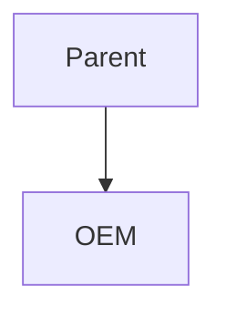

# Sample Artifact

> **Status:** drafted · **Confidence:** 0.5 — sample

## Section One
A paragraph with **bold**, *italic*, `code`, and a [link](https://help.salesforce.com).

## A Table
| Grant | Category | Quantity |
|-------|----------|----------|
| UE Sites | Feature | 1,000,000 |

## A Diagram

## A List
- one
- two
