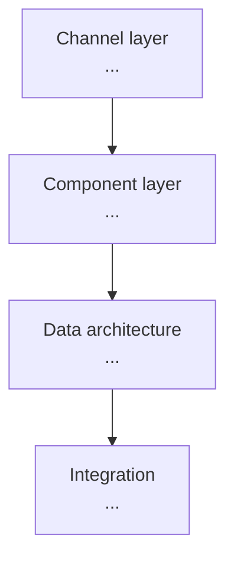

# [Partner Name] — Technical & Architectural Assessment
**Date:** [YYYY-MM-DD] · **Prepared by:** [name, role]
**Associated POV:** [link or "none"] · **Associated Discovery:** [link or "none"]
**Overall Well-Architected Readiness:** [0.0–1.0]

---

## Part 0 — Executive Readiness Summary

**Well-Architected Readiness (RAG):**

| Pillar | Quality | Rating | Finding |
|---|---|---|---|
| Trusted | Secure | [🟢/🟡/🔴] | [one line] |
| Trusted | Compliant | [🟢/🟡/🔴] | [one line] |
| Trusted | Reliable | [🟢/🟡/🔴] | [one line] |
| Easy | Intentional | [🟢/🟡/🔴] | [one line] |
| Easy | Automated | [🟢/🟡/🔴] | [one line] |
| Easy | Engaging | [🟢/🟡/🔴] | [one line] |
| Adaptable | Resilient | [🟢/🟡/🔴] | [one line] |
| Adaptable | Composable | [🟢/🟡/🔴] | [one line] |

**Pillar rollup:** Trusted [🟢/🟡/🔴] · Easy [🟢/🟡/🔴] · Adaptable [🟢/🟡/🔴]

**Top 3 technical risks:**
1. [risk] — quality: [name] · severity: [Critical/High/Medium/Low]
2. [risk] — quality: [name] · severity: [...]
3. [risk] — quality: [name] · severity: [...]

**Build-readiness verdict:** [Go / Conditional-Go / Not-ready] — [one-line justification]

---

## Part 1 — Current-State Assessment

> Evaluated against Salesforce Well-Architected. Each quality has a Finding, Evidence (confidence-labeled), Pattern/Anti-pattern, and Gap. A quality with no evidence renders fully `[TBD]` with a "what to confirm" note — never invented.

### Trusted

#### Secure
**Finding:** [what the current architecture does]
**Evidence:** [source: POV section / Discovery Theme B / research] `[confirmed | proposed — confirm | TBD]`
**Pattern / Anti-pattern:** [named pattern or anti-pattern]
**Gap:** [what's missing for Salesforce-grade]

#### Compliant
**Finding:** [finding]
**Evidence:** [source] `[label]`
**Pattern / Anti-pattern:** [named]
**Gap:** [gap]

#### Reliable
**Finding:** [finding]
**Evidence:** [source] `[label]`
**Pattern / Anti-pattern:** [named]
**Gap:** [gap]

### Easy

#### Intentional
**Finding:** [finding]
**Evidence:** [source] `[label]`
**Pattern / Anti-pattern:** [named]
**Gap:** [gap]

#### Automated
**Finding:** [finding]
**Evidence:** [source] `[label]`
**Pattern / Anti-pattern:** [named]
**Gap:** [gap]

#### Engaging
**Finding:** [finding]
**Evidence:** [source] `[label]`
**Pattern / Anti-pattern:** [named]
**Gap:** [gap]

### Adaptable

#### Resilient
**Finding:** [finding]
**Evidence:** [source] `[label]`
**Pattern / Anti-pattern:** [named]
**Gap:** [gap]

#### Composable
**Finding:** [finding]
**Evidence:** [source] `[label]`
**Pattern / Anti-pattern:** [named]
**Gap:** [gap]

---

## Part 2 — Target-State Architecture

**1. App type & packaging:** [recommendation — or `[TBD]`] _(serves: Composable)_
**2. Data architecture:** [recommendation] _(serves: Reliable, Compliant)_
**3. Integration architecture:** [named systems, API style, auth, sync/async] _(serves: Resilient)_
**4. Component architecture:** [LWC / Apex / Flow division] _(serves: Automated, Engaging)_
**5. Security & sharing model:** [perm sets, sharing, protection] _(serves: Secure)_
**6. Scale & multi-tenancy:** [governor-limit + scale strategy] _(serves: Reliable, Resilient)_
**7. AI & data layer:** [Agentforce / Einstein / Data Cloud + licenses — or "Not applicable"] _(serves: Intentional)_

**Target-state architecture diagram** — one node per layer the POV populates; edges show dependency/data direction. Build per `refs/mermaid-diagrams.md` (prepend the theme directive); a `[TBD]` layer renders as `[TBD — confirm in build]`, never invented. Renders natively on GitHub/GitLab.



---

## Part 3 — Build-Ready Spec & Stubs

> Markdown is the build-consumable source of truth. Every artifact below traces to a POV use case or a Part 2 decision (see the Traceability / Serves column). Stubs are signatures/scaffolding only — no business-logic bodies.

**Metadata blueprint — custom objects & fields:**

| Object (API name) | Field (API name) | Type | Description | Traceability |
|---|---|---|---|---|
| [Object__c] | [Field__c] | [Text/Lookup/…] | [purpose] | [use case / Part 2 decision] |

**Relationships / ERD:**
```
[Object_A__c] 1──* [Object_B__c]   (master-detail / lookup)
```

**Component inventory:**

| Component | Type | Responsibility | Serves (use case / quality) |
|---|---|---|---|
| [Name] | [LWC / Apex / Flow] | [one line] | [traceability] |

**Integration contracts:**

| External system | API | Auth | Sync/Async | SF-side mechanism | Data exchanged |
|---|---|---|---|---|---|
| [System] | [named API] | [Named Credential / OAuth] | [sync/async] | [Platform Event / External Service / …] | [data] |

_If the solution has no external integrations, replace this table with "No external integrations."_

**Skeleton stubs:**

<!-- For implementation details not yet decided, write `[TBD — confirm in build]` (not bare `[TBD]`). -->

```apex
// STUB — scaffolding from Architecture Assessment; flesh out in build
public with sharing class [ClassName] {
    // Serves: [use case / quality]
    public [ReturnType] [methodName]([Type] [param]) {
        // TODO (build): [intent in one line]
    }
}
```

```javascript
// STUB — scaffolding from Architecture Assessment; flesh out in build
// LWC: [componentName] — serves [use case]
import { LightningElement, api } from 'lwc';
export default class [ComponentName] extends LightningElement {
    @api [propName]; // [purpose]
    // TODO (build): [intent]
}
```

```html
<!-- STUB — scaffolding from Architecture Assessment; flesh out in build -->
<!-- LWC template: [componentName] -->
<template>
    <!-- TODO (build): [markup structure for [propName]] -->
</template>
```

```xml
<!-- STUB — scaffolding from Architecture Assessment; flesh out in build -->
<!-- [Object__c].object-meta.xml — serves [use case]; trace to Part 2 data architecture -->
<CustomObject xmlns="http://soap.sforce.com/2006/04/metadata">
    <label>[Object label]</label>
    <!-- TODO (build): add fields; mark undecided config [TBD — confirm in build] -->
</CustomObject>
```

---

## Part 4 — Gap-Closing Roadmap → MVP Build Plan handoff

| # | Gap-closing work item | Closes quality | Priority | Notes |
|---|---|---|---|---|
| 1 | [item] | [quality] | [H/M/L] | [note] |
| 2 | [item] | [quality] | [H/M/L] | [note] |

**Handoff to MVP Build Plan (Stage 8):** the build sequence above feeds Stage 8 — each target-state component and gap-closing item becomes a build task. Generate the MVP Build Plan next to turn this into sprint-ready user stories and a phase plan.

---

## Confidence & Assumptions
**Overall Well-Architected Readiness:** [0.0–1.0]
**Assumptions this rests on:**
1. [assumption]
**Open `[TBD]`s:** [list, or "All sections evidenced"]
